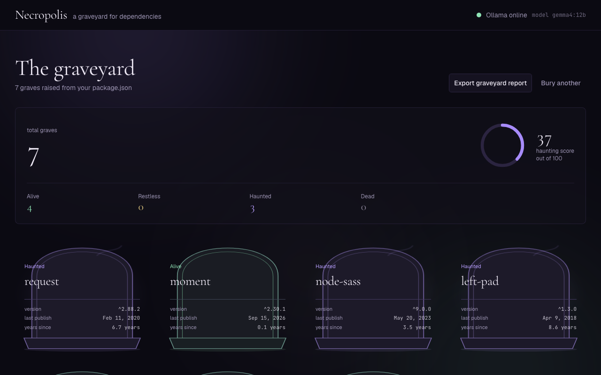
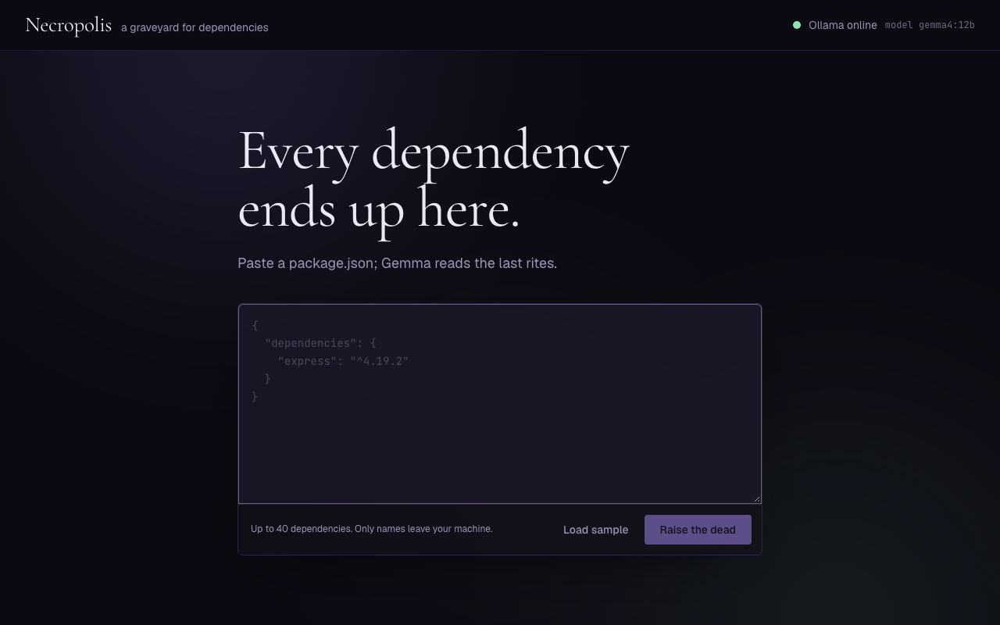
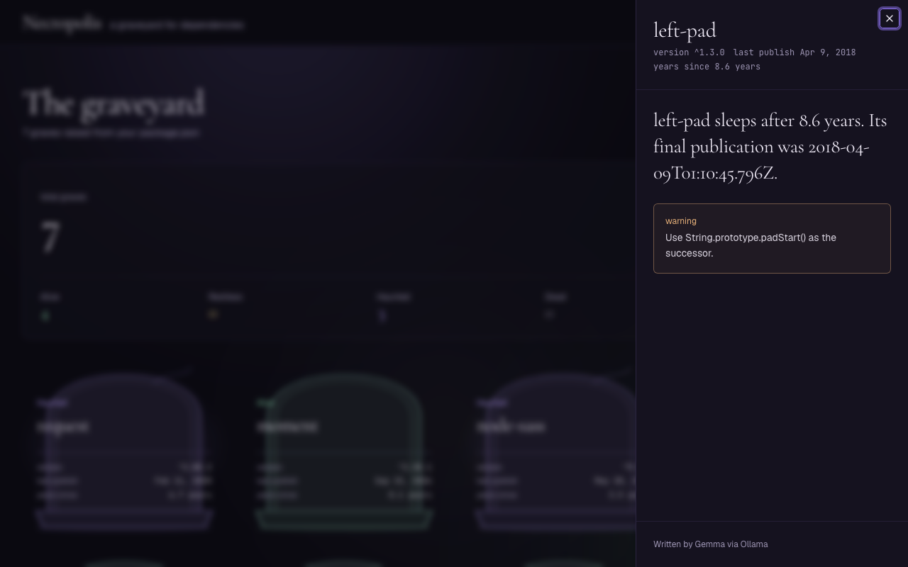
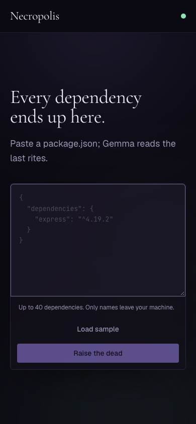

<div align="center">

# Necropolis

**A graveyard for your dependencies.**

Paste a `package.json`. Every dependency rises as a headstone, and a local Gemma model writes the eulogy.

[](https://nextjs.org)
[](https://react.dev)
[](https://tailwindcss.com)
[](#scripts)
[](https://ollama.com)

[Quickstart](#quickstart) · [How it works](#how-it-works) · [API](#api-routes) · [Configuration](#configuration) · [Troubleshooting](#troubleshooting)



</div>

---

## Quickstart

```bash
git clone https://github.com/mannubaveja007/necropolis.git
cd necropolis
npm install
ollama pull gemma3:4b
ollama serve
npm run dev
```

Open <http://localhost:3000>, paste a `package.json` (or press **Load sample**), then **Raise the dead**.

Requires **Node.js 20.9+** and [Ollama](https://ollama.com/) running locally.

> [!TIP]
> Already have a Gemma model installed? Run `ollama list`, then set `OLLAMA_MODEL` to that tag in `.env.local` and skip the pull. A 12B model works, but the first epitaph can take a minute on CPU.

---

## How it works

1. **Paste.** The browser sends the file to `POST /api/scan`.
2. **Scan.** The server merges `dependencies` and `devDependencies` (up to **40**), then fetches each package from the public npm registry in parallel. Each request times out after **5 seconds**; a 404 or a dead registry becomes `unknown` instead of failing the scan.
3. **Bury.** Each package is drawn as an SVG headstone, coloured and weathered by its status.
4. **Read the rites.** Clicking a stone sends only five facts to `POST /api/epitaph`: name, version, last publish, years since publish, and deprecation message. Ollama answers in JSON (`stream: false`, `format: "json"`), and the answer is cached in memory per package.
5. **Fall back, never fail.** If Ollama is unreachable or returns something unreadable, the API answers with a deterministic template and the panel shows **Ghost offline: template epitaph**.
6. **Export.** **Export graveyard report** downloads a Markdown file with the status table plus every epitaph you have opened.

### Statuses

| Status | Rule | Stone |
| --- | --- | --- |
| `alive` | Latest publish under 1 year ago | moonlit green |
| `restless` | 1–2 years ago | pale gold |
| `haunted` | The registry returns a deprecation message | violet, slow ghost glow |
| `dead` | Latest publish more than 2 years ago | ash, with cracks and moss |
| `unknown` | 404, network error or timeout | cold slate, dashed outline |

Deprecation wins over age: `request` is six years old and still **haunted**, not dead. The sample also includes `node-sass` and `left-pad` (haunted), `moment` and `express` (alive), and `react` (alive).

### Haunting Score

Each package contributes a weight; the mean is scaled to 0–100. A graveyard of only dead dependencies scores 100, only alive scores 5.

| Status | Weight |
| --- | --- |
| `dead` | 1.0 |
| `haunted` | 0.8 |
| `unknown` | 0.65 |
| `restless` | 0.45 |
| `alive` | 0.05 |

---

## Screens

| The gate | The rites |
| --- | --- |
|  |  |

<details>
<summary>Mobile layout</summary>
<br />

</details>

---

## API routes

| Method | Route | Body | Returns |
| --- | --- | --- | --- |
| `POST` | `/api/scan` | `{ "packageJson": "<file contents>" }` | `{ packages, summary }` |
| `POST` | `/api/epitaph` | `{ name, version, lastPublish, yearsSince, deprecatedMessage }` | `{ name, version, epitaph, warning, source }` |
| `GET` | `/api/health` | none | `{ ollama, model, url, latencyMs }` |

`source` is `"ollama"` when the model answered and `"template"` when it fell back. The header polls `/api/health` every 30 seconds and shows a green or red dot beside the model name.

---

## Configuration

Both variables are optional. Copy `.env.example` to `.env.local`, then restart `npm run dev`.

| Variable | Default | Purpose |
| --- | --- | --- |
| `OLLAMA_URL` | `http://localhost:11434/api/generate` | Full Ollama generate endpoint. Point it at a remote host if you run Ollama elsewhere. |
| `OLLAMA_MODEL` | `gemma3:4b` | Model tag passed to Ollama. Any tag from `ollama list`. |
| `OLLAMA_TIMEOUT_MS` | `180000` | How long to wait for one generation before the template epitaph is used. |

---

## Project structure

```text
src/
├── app/
│   ├── api/                  # scan, epitaph and health route handlers
│   ├── globals.css           # design tokens, fog, type, tombstone styles
│   ├── layout.tsx            # fonts, header and footer
│   └── page.tsx              # landing, scan and graveyard states
├── components/
│   ├── epitaph-panel.tsx     # sheet, request, client cache, fallback banner
│   ├── loading-graveyard.tsx # summary and grid skeletons
│   ├── summary-bar.tsx       # counts and Haunting Score ring
│   ├── tombstone.tsx         # SVG headstone: cracks, moss, ghost glow
│   ├── tombstone-grid.tsx    # responsive grid
│   ├── site-header.tsx       # wordmark and live Ollama state
│   └── site-footer.tsx       # privacy line
└── lib/
    ├── npm.ts                # parsing, registry lookup, statuses, score
    ├── epitaph.ts            # prompt, cache, deterministic fallback
    ├── report.ts             # Markdown report builder
    ├── sample.ts             # the sample package.json
    └── types.ts              # shared contracts
```

Tests sit beside their modules (`*.test.ts`), with 52 cases across parsing, status boundaries, scoring, route errors, the Ollama fallback and report formatting.

---

## Privacy

> **Open-weight Gemma via Ollama. Only package names leave your machine, to the public npm registry.**

Scanning sends package names to the public npm registry to read publish dates and deprecation notices. Epitaph generation sends only those five facts to your own Ollama instance. Your `package.json` never leaves your machine.

---

## Scripts

| Script | Command | Purpose |
| --- | --- | --- |
| `dev` | `next dev` | Development server at <http://localhost:3000> |
| `build` | `next build` | Production build |
| `start` | `next start` | Serve the production build |
| `test` | `vitest run` | Run the 52 tests once |
| `typecheck` | `tsc --noEmit` | Type-check without emitting |
| `lint` | `eslint` | Lint the project |

---

## Troubleshooting

<details>
<summary><strong>Ollama is offline</strong></summary>

The header turns red and epitaphs fall back to templates. Start it with `ollama serve`, then check <http://localhost:3000/api/health>. If Ollama lives on another host, set `OLLAMA_URL` to its `/api/generate` endpoint and restart the dev server.

</details>

<details>
<summary><strong>The model is not installed</strong></summary>

`ollama list` shows what you have. Either `ollama pull gemma3:4b`, or set `OLLAMA_MODEL` to an installed Gemma tag. Requests fail over to the template rather than erroring.

</details>

<details>
<summary><strong>Epitaphs take a long time</strong></summary>

A 12B model on CPU can need a minute or more, especially on the first call while the weights load. The rail shows a skeleton while it works. Successful answers are cached per package for the life of the server.

</details>

<details>
<summary><strong>Packages show as <code>unknown</code></strong></summary>

A 404, a rate-limited registry, or a request that misses the 5-second timeout all become `unknown`. Wait a moment and rescan, or scan a smaller `package.json`.

</details>

<details>
<summary><strong>Only 40 dependencies are scanned</strong></summary>

The cap covers `dependencies` and `devDependencies` together. Split a very large manifest to see everything.

</details>

---

## Design

The interface is a custom dark-gothic direction: near-black `#0b0a12`, violet and moonlit-green accents, Cormorant Garamond for display, Geist for text, JetBrains Mono for carved data, and a slow CSS fog that respects `prefers-reduced-motion`.

It was built with the [Hallmark](https://github.com/nutlope/hallmark) design skill, vendored at `.agents/skills/hallmark`. The render sweep is clean: **0 FAIL, 0 WARN** at 320–1920 px, with two recorded dismissals (the sheet scrim and wrapping tombstone meta).

```bash
node .agents/skills/hallmark/scripts/sloplint.mjs src --render --url http://localhost:3000
```

---

## Commit conventions

Every commit follows [Conventional Commits](https://www.conventionalcommits.org/) and carries one logical change.

- `type(scope): summary` — imperative, 72 characters max, no trailing period.
- Types: `feat`, `fix`, `docs`, `chore`, `refactor`, `test`, `perf`, `style`.
- No `wip` or `fixup` commits on `main`; history is never rewritten once pushed.

<div align="center">
<br />
<sub>Built with Next.js, Tailwind CSS, and a local Gemma model.</sub>
</div>
