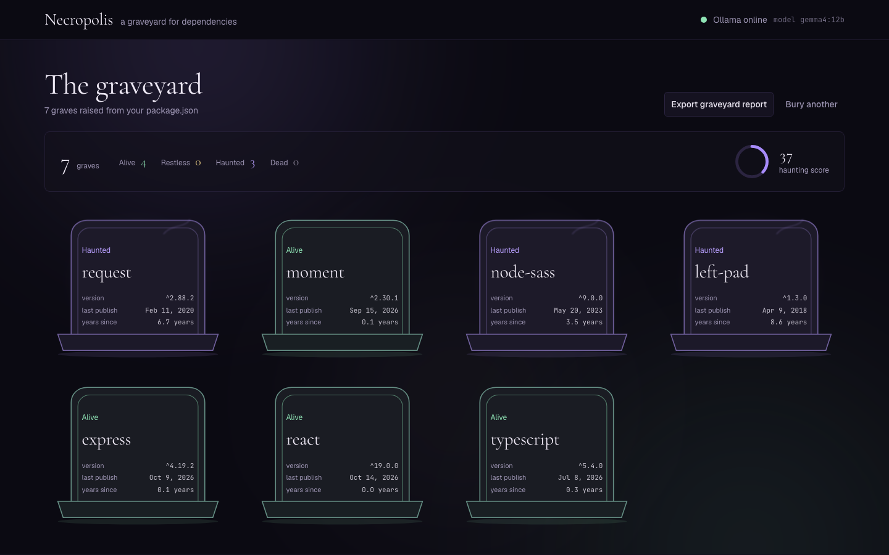

# Necropolis 🪦

> A dark-gothic dependency graveyard. Paste a `package.json`, and every package rises as a headstone with a registry-verified fate, a Haunting Score, and an epitaph written locally by Gemma through Ollama.



---

## Architecture Overview

```
┌──────────────────────────────────────────────────────────────────┐
│ Browser — Next.js 16 client                                      │
│ paste package.json → Raise the dead → graveyard                  │
└──────────────────────────────┬───────────────────────────────────┘
                               │ POST /api/scan
                               ▼
┌──────────────────────────────────────────────────────────────────┐
│ Next.js route handlers (App Router, RSC)                         │
│ POST /api/scan · POST /api/epitaph · GET /api/health             │
└──────────────────────────────┬───────────────────────────────────┘
                               │ Promise.all
                               ▼
┌──────────────────────────────────────────────────────────────────┐
│ registry.npmjs.org — one GET per package                         │
│ 5s timeout · latest · time[latest] · deprecated                  │
└──────────────────────────────┬───────────────────────────────────┘
                               │ statuses → headstones → click a stone
                               ▼
┌──────────────────────────────────────────────────────────────────┐
│ Ollama — local Gemma, format:"json"                              │
│ validate → memory cache → template fallback                      │
└──────────────────────────────┬───────────────────────────────────┘
                               ▼
                               Epitaph panel · Markdown report
```

| Method | Route | Purpose |
| --- | --- | --- |
| `POST` | `/api/scan` | Body `{ packageJson }`; returns `{ packages, summary }` |
| `POST` | `/api/epitaph` | Body `{ name, version, lastPublish, yearsSince, deprecatedMessage }`; returns `{ epitaph, warning, source }` |
| `GET` | `/api/health` | Returns `{ ollama, model, url, latencyMs }` for the header dot |

> **Privacy.** Only package names leave your machine, to the public npm registry. Epitaph facts go only to your local Ollama instance.

---

## Project Structure

```text
Necropolis/
├── src/
│   ├── app/
│   │   ├── api/                      # scan, epitaph and health route handlers
│   │   ├── globals.css               # design tokens, fog, type, headstone styles
│   │   ├── layout.tsx                # fonts, header and footer
│   │   └── page.tsx                  # landing, scan and graveyard states
│   ├── components/
│   │   ├── epitaph-panel.tsx         # sheet, request, client cache, fallback banner
│   │   ├── loading-graveyard.tsx     # summary and grid skeletons
│   │   ├── summary-bar.tsx           # counts and Haunting Score ring
│   │   ├── tombstone.tsx             # SVG headstone: cracks, moss, ghost glow
│   │   ├── tombstone-grid.tsx        # responsive grid
│   │   ├── site-header.tsx           # wordmark and live Ollama state
│   │   ├── site-footer.tsx           # privacy line
│   │   └── ui/                       # shadcn primitives
│   └── lib/
│       ├── npm.ts                    # parsing, registry lookup, statuses, score
│       ├── epitaph.ts                # prompt, cache, deterministic fallback
│       ├── report.ts                 # Markdown report builder
│       ├── sample.ts                 # the sample package.json
│       └── types.ts                  # shared contracts
├── docs/screenshots/                 # README captures
├── .agents/skills/hallmark/          # vendored design skill
└── .env.example                      # environment specification
```

---

## Core Capabilities

### 1. Parallel Registry Scan
- Merges `dependencies` and `devDependencies` (dev wins on duplicates), dedupes, and stops at **40 packages**.
- Fetches every package from `registry.npmjs.org` in parallel with a **5-second timeout** per request, scoped names included.
- Reads `dist-tags.latest`, `time[latest]` and `versions[latest].deprecated`.
- Any 404, timeout, network error or unreadable body becomes an `unknown` headstone; a single bad package never sinks the scan.

### 2. Five Fates and a Haunting Score
| Status | Rule | Stone |
| --- | --- | --- |
| `alive` | Latest publish under 1 year ago | moonlit green |
| `restless` | 1–2 years ago | pale gold |
| `haunted` | Registry returns a deprecation message | violet, slow ghost glow |
| `dead` | More than 2 years since the latest publish | ash, cracks and moss |
| `unknown` | 404, timeout or unreachable registry | cold slate, dashed outline |

Deprecation outranks age: `request` is 6.7 years old and still **haunted**, not dead. Each status feeds the **Haunting Score** (0–100): `dead 1.0`, `haunted 0.8`, `unknown 0.65`, `restless 0.45`, `alive 0.05`, scaled as a mean.

### 3. Headstones That Decay
- Every package is a `<button>` with an inline SVG slab, base plinth and carved meta: name, version, last publish, years since.
- `dead` stones grow cracks and moss; `haunted` stones pulse a slow ghost glow; hover raises a candle glow instead of a generic lift.
- Portrait on phones, four columns on desktop, and every animation collapses under `prefers-reduced-motion`.

### 4. Epitaphs Written Locally
- Clicking a stone sends **only five facts**: name, version, last publish, years since, deprecation message.
- Ollama answers with `stream: false`, `format: "json"` and a fixed gravedigger prompt that forbids invented dates, versions, CVEs and package names.
- Successful answers are cached in memory per `name@version`; the panel shows a skeleton, a readable error with **Try again**, and whether the source was the model or the template.


### 5. Graceful Degradation
- When Ollama is down or returns bad JSON, the API answers with a deterministic two-sentence epitaph and a one-sentence warning.
- The panel shows **Ghost offline: template epitaph** and can retry without caching the fallback.
- The header polls `/api/health` every 30 seconds and switches a green dot to red with the model name.

### 6. Markdown Export
- **Export graveyard report** downloads a Markdown file: UTC generation time, totals with the Haunting Score, a status table, and one epitaph section per package opened.
- Table cells escape pipes and newlines; missing dates become em dashes; input order is preserved.

---

## Quickstart & Local Setup

### 1. Prerequisites
- **Node.js**: `v20.9+`
- **Ollama**: running locally on `http://localhost:11434`
- **A Gemma model**: `gemma3:4b` by default; any tag from `ollama list` works

```bash
ollama pull gemma3:4b
ollama serve
```

> [!TIP]
> Already running a larger model? Set `OLLAMA_MODEL` to that tag and skip the pull. A 12B model on CPU can take a minute for the first epitaph.

### 2. Configure Environment Variables

```bash
cp .env.example .env.local
```

| Variable | Default | Purpose |
| --- | --- | --- |
| `OLLAMA_URL` | `http://localhost:11434/api/generate` | Full generate endpoint; point it at a remote host if needed |
| `OLLAMA_MODEL` | `gemma3:4b` | Model tag passed to Ollama |
| `OLLAMA_TIMEOUT_MS` | `180000` | Wait before the template fallback |

### 3. Install Dependencies

```bash
npm install
```

### 4. Start the Application

```bash
npm run dev
```

Open <http://localhost:3000>. The header turns green once `/api/health` can reach Ollama.

### 5. Raise Your First Graveyard
1. Press **Load sample**, or paste any `package.json` with `dependencies` or `devDependencies`.
2. Press **Raise the dead**.
3. Read the stones, then click one to summon its epitaph.
4. Press **Export graveyard report** to keep the yard.


---

## Sample Graveyard & Scan Management

The sample manifest is built to exercise the whole yard:

1. **`request`** — deprecated since 2020, haunted despite its age.
2. **`node-sass`** — deprecated in favour of `sass`, haunted.
3. **`left-pad`** — deprecated with a named successor, haunted.
4. **`moment`**, **`express`**, **`react`** — recent publishes, alive.
5. **`typescript`** — the seventh grave, pulled from `devDependencies`.

**Bury another** returns to the gate without clearing your epitaph cache. Scans are capped at 40 packages, and packages beyond the cap, or packages the registry cannot answer for, appear as `unknown` rather than blocking the rest.

---

## Verification & Audit Commands

```bash
# 52 unit tests across parsing, statuses, scoring, routes, fallback and report
npm test

# TypeScript, without emitting
npm run typecheck

# Production build
npm run build

# Hallmark design sweep (needs the dev server running)
node .agents/skills/hallmark/scripts/sloplint.mjs src --render --url http://localhost:3000
```

The design sweep is clean at 320–1920 px: **0 FAIL, 0 WARN**, with two recorded dismissals (the sheet scrim and the wrapping tombstone meta).

---

## Design System & Hallmark Principles

The interface follows a custom dark-gothic direction built with the **Hallmark v2.0.0** skill:

- **Tokens only**: near-black `#0b0a12`, violet `#a78bfa`, moonlit green `#8fe3b5`; every colour flows through a semantic token.
- **Typography**: Cormorant Garamond for display, Geist for text, JetBrains Mono for carved data such as versions and dates.
- **Surfaces and motion**: a slow CSS fog (transform only), candle-glow hover, animated ghost glow, all respecting `prefers-reduced-motion`.
- **Access and craft**: visible focus rings, AA contrast, 40 px controls, no `transition: all`, and no invented metrics or testimonials.

The skill is vendored at `.agents/skills/hallmark` (MIT, pinned in `skills-lock.json`) with the build recorded in `.hallmark/log.json`.
